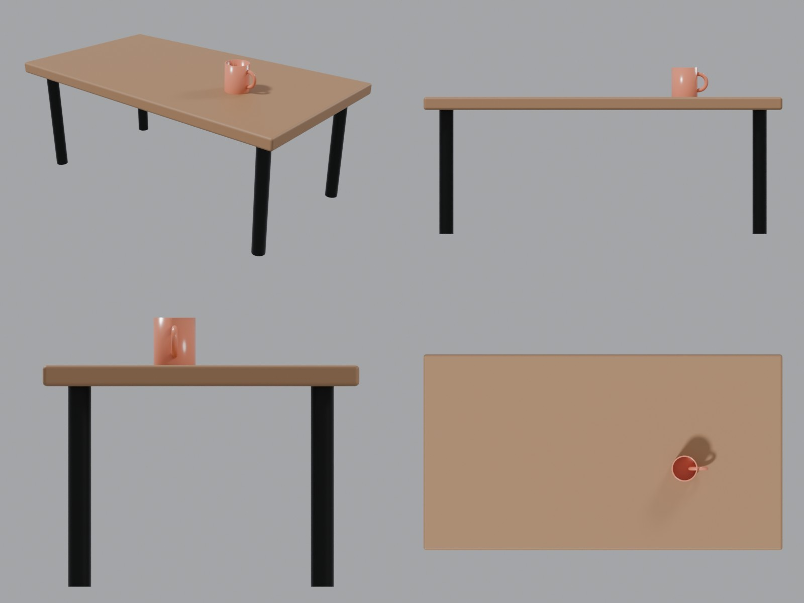

# blender-cloud-session

Faire créer des modèles 3D par Claude Code **en session cloud** (claude.ai/code), avec Blender en headless
sur la VM. Claude écrit un script Python par modèle, le génère avec Blender, regarde les rendus, corrige,
puis, quand tu lui donnes ton accord, pousse sur une branche au nom de l'objet (`model/<nom>`) :

- le `.blend` ;
- des screenshots (4 vues et une grille d'aperçu) ;
- un README par modèle qui affiche l'aperçu directement sur GitHub.



## Configuration (une seule fois)

Sur [claude.ai/code](https://claude.ai/code), ouvre les paramètres de l'environnement cloud que tu utiliseras
pour ce repo, ou crée un environnement dédié, par exemple « Blender ».

1. **Accès réseau** → `Custom`.
   - Dans *Allowed domains*, ajouter `download.blender.org`.
   - Cocher *Also include default list of common package managers*.
2. **Setup script** (recommandé) : coller tout le contenu de [`scripts/setup_blender.sh`](scripts/setup_blender.sh).
   Blender est alors installé une fois puis mis en cache, et les sessions démarrent vite.
   Sans setup script, le hook SessionStart du repo installe quand même Blender, mais à chaque nouvelle
   session, ce qui prend environ 1 à 2 minutes. L'étape 1 reste indispensable dans les deux cas.

## Utilisation

Lance une session sur ce repo avec cet environnement, puis demande par exemple :

> Crée une lampe de bureau articulée, style scandinave, en bois clair et métal blanc.

Claude crée la branche `model/lampe-bureau` et le script `models/lampe-bureau/build.py`, génère le modèle,
vérifie les rendus, te les décrit et te demande s'il peut pousser. **Rien ne part sur GitHub sans ton
accord explicite** : tant que tu ne dis pas « oui », le travail reste sur la VM de la session. Le push
affiche aussi une demande de permission (règle `ask` dans `.claude/settings.json`).

Attention, la VM est éphémère : un modèle jamais poussé est perdu à la fin de la session.

Pour récupérer le résultat une fois poussé :

- **Sur GitHub** : ouvre la branche `model/<nom>`, puis `models/<nom>/README.md`. L'aperçu et les vues s'affichent.
- **En local** : `git fetch && git checkout model/<nom>`, puis ouvre `models/<nom>/<nom>.blend` dans Blender.

Pour une retouche, il suffit de continuer la conversation, par exemple « pieds plus fins » ou « ajoute un
tiroir ». Les retouches restent locales jusqu'à ton prochain accord, et chaque push ajoute un seul commit
sur la même branche. L'historique ne garde donc pas un `.blend` par essai. Dans une nouvelle session, demande par exemple
« retouche lampe-bureau : … » : Claude repart de la branche `model/lampe-bureau`.

Pour regrouper un modèle terminé dans `main`, fusionne sa branche (pull request sur GitHub).

## Structure

```
CLAUDE.md                     instructions pour Claude (workflow, conventions)
.claude/settings.json         hook SessionStart + permissions (git push demande confirmation)
.claude/hooks/session-start.sh  installe Blender si absent (sessions cloud uniquement)
scripts/setup_blender.sh      installation de Blender 5.2 (setup script / hook)
tools/build.sh                bash tools/build.sh models/<nom> : génère tout le modèle
tools/build.py                scène vide → build.py → .blend → screenshots → README
tools/preview.py              rendus Cycles CPU multi-vues + grille (utilisable sur tout .blend)
tools/helpers.py              matériaux, bevel, lissage
models/<nom>/build.py         le script source d'un modèle (le reste est généré)
```

## En local (optionnel)

Avec Blender 5.2 installé :

```bash
BLENDER="/chemin/vers/blender" bash tools/build.sh models/exemple-table
```

## Limites

- **Pas de GPU** sur la VM : les rendus utilisent Cycles sur CPU, quelques secondes à quelques minutes par
  vue selon la scène. EEVEE n'est pas disponible.
- **Pas de MCP Blender** : en session cloud, Claude a un terminal et pilote Blender directement par
  scripts, ce qui est plus simple et plus fiable en headless. Un MCP pourra être ajouté plus tard pour des
  intégrations précises (bibliothèques d'assets, génération 3D…).
- Les fichiers de plus de 100 Mo sont refusés par GitHub.
