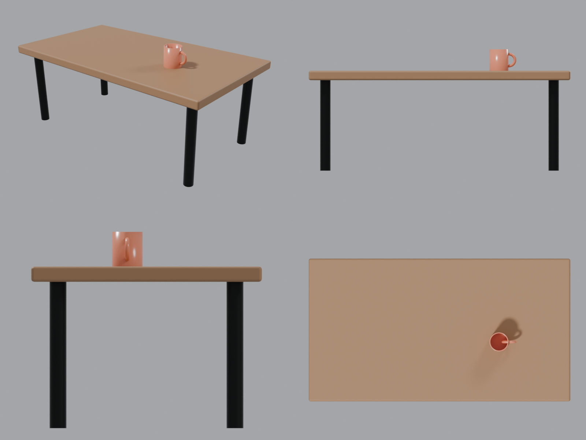

# exemple-table

Table basse en bois avec une tasse : modèle d'exemple, qui sert aussi de test du pipeline.

Vues : [iso](screenshots/iso.png) · [front](screenshots/front.png) · [right](screenshots/right.png) · [top](screenshots/top.png)

| Fichier | Contenu |
|---|---|
| [`exemple-table.blend`](exemple-table.blend) | Fichier Blender 5.2.3 LTS |
| [`exemple-table.glb`](exemple-table.glb) | Export glTF binaire (web, Godot, Unity…) |
| [`build.py`](build.py) | Script qui génère le modèle |

**Dimensions** : 1.100 × 0.600 × 0.510 m (X × Y × Z) · **Objets** : 7 · **Sommets** : 1 056 · **Faces** : 924
