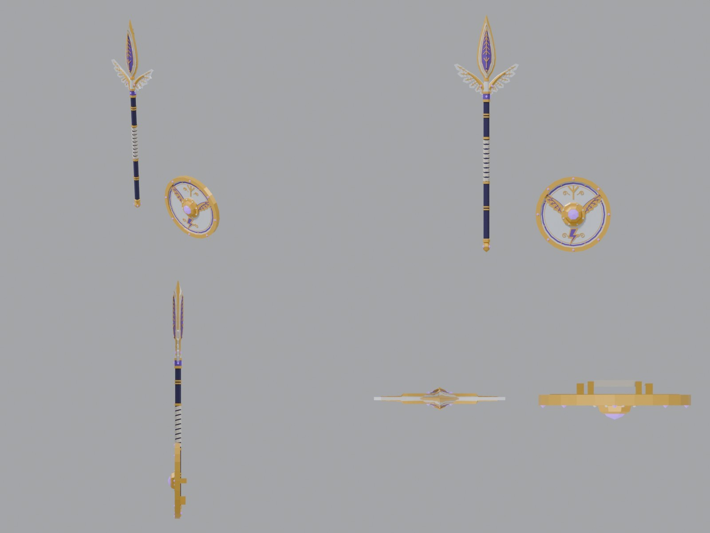

# javelot-valkyrie-ailes

Javelot de Valkyrie « Ailes d'argent » : lance courte à une main (1,70 m). Fer en feuille d'argent bien
en volume (arête centrale, 7 cm d'épaisseur), biseau d'or, panneau violet orné d'une rune ᛉ, d'une plume
gravée, d'un double filet et de perles d'or ; ailes de valkyrie en plumes barbées d'or sur la douille,
poignée gainée de cuir blanc, pommeau doré serti de gemmes violettes. Targe ronde (54 cm) argent et or :
gemme violette, ailes en relief, rune ᛉ, éclair, volutes en filigrane et cercle perlé.
Style Roblox : facettes plates, pièces en blocs, motifs en relief.

Vues : [iso](screenshots/iso.jpg) · [front](screenshots/front.jpg) · [right](screenshots/right.jpg) · [top](screenshots/top.jpg)

| Fichier | Contenu |
|---|---|
| [`javelot-valkyrie-ailes.blend`](javelot-valkyrie-ailes.blend) | Fichier Blender 5.2.3 LTS |
| [`build.py`](build.py) | Script qui génère le modèle |

**Dimensions** : 1.122 × 0.140 × 1.697 m (X × Y × Z) · **Objets** : 27 · **Sommets** : 4 836 · **Faces** : 3 863
