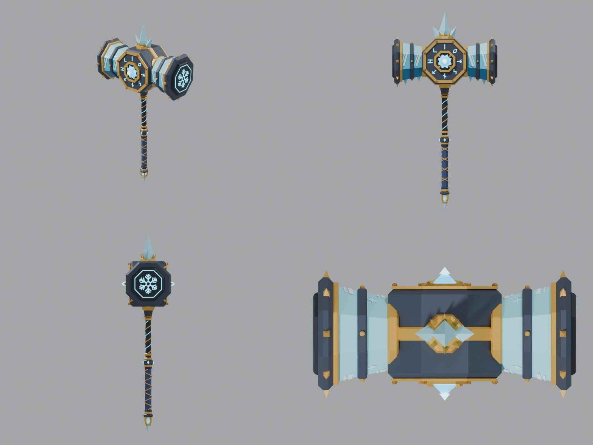

# marteau-runique-enclume

Marteau de Permafrost « Enclume runique », dérivé de la variante runique, en style Roblox low-poly : au centre
un grand médaillon octogonal de fer cerclé d'or où un orbe d'énergie est entouré d'un anneau de huit runes
lumineuses ; de chaque côté la glace turquoise s'évase jusqu'à des embouts massifs cloutés d'or, frappés d'un
flocon. Couronne de cristaux, manche de fer incrusté d'une spirale d'or et pommeau-cage tenant un petit orbe
(environ 2,5 m de haut).

Vues : [iso](screenshots/iso.jpg) · [front](screenshots/front.jpg) · [right](screenshots/right.jpg) · [top](screenshots/top.jpg)

| Fichier | Contenu |
|---|---|
| [`marteau-runique-enclume.blend`](marteau-runique-enclume.blend) | Fichier Blender 5.2.3 LTS |
| [`build.py`](build.py) | Script qui génère le modèle |

**Dimensions** : 1.348 × 0.680 × 2.530 m (X × Y × Z) · **Objets** : 74 · **Sommets** : 7 784 · **Faces** : 6 876
