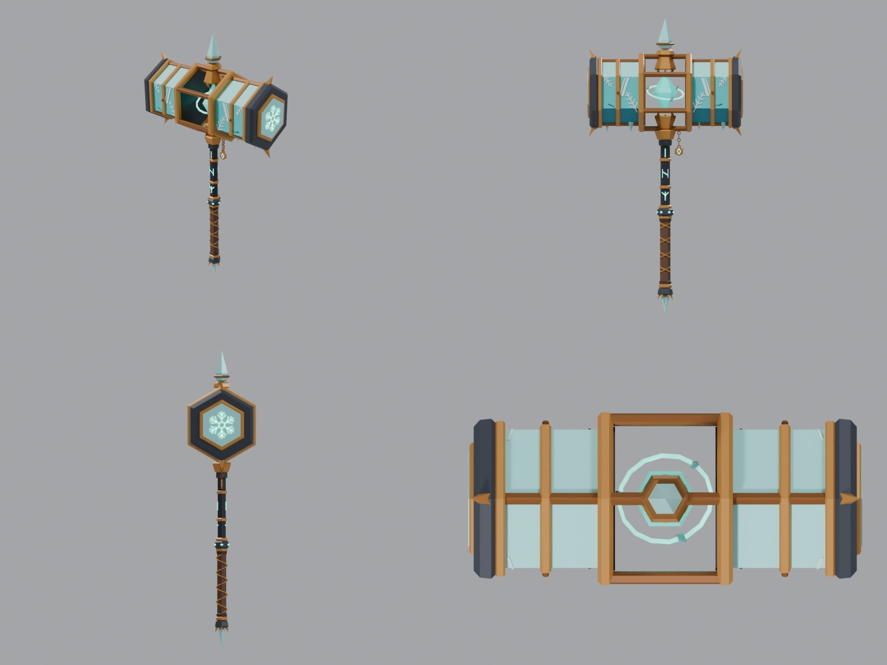

# marteau-runique-reliquaire

Marteau de Permafrost « Reliquaire runique », dérivé de la variante runique, en style Roblox low-poly : au
centre, une cage de bronze ouverte laisse voir le cœur d'énergie, un grand cristal aigue-marine suspendu entre
deux coupelles et ceint d'un anneau lumineux en orbite. De chaque côté, la glace est taillée en prismes
hexagonaux givrés de fougères de glace. Les embouts cornus portent une vitre de glace où brille un flocon, et
un médaillon runique pend à une chaîne (environ 2,6 m de haut).

Vues : [iso](screenshots/iso.jpg) · [front](screenshots/front.jpg) · [right](screenshots/right.jpg) · [top](screenshots/top.jpg)

| Fichier | Contenu |
|---|---|
| [`marteau-runique-reliquaire.blend`](marteau-runique-reliquaire.blend) | Fichier Blender 5.2.3 LTS |
| [`build.py`](build.py) | Script qui génère le modèle |

**Dimensions** : 1.374 × 0.600 × 2.606 m (X × Y × Z) · **Objets** : 67 · **Sommets** : 5 918 · **Faces** : 4 483
