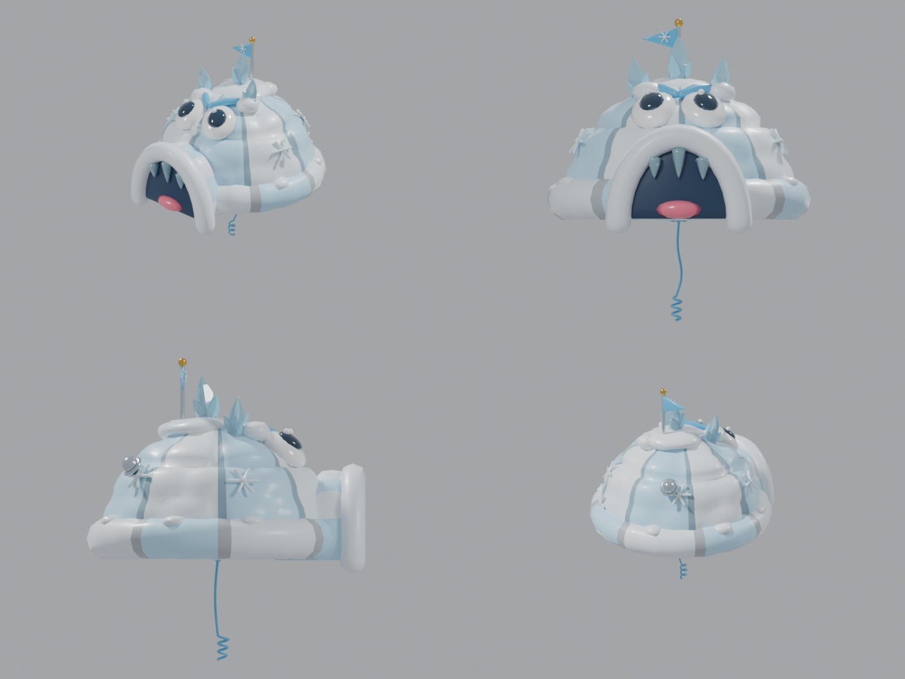

# monde-3-glace

Monde 3 « Le Royaume Givré » : modèle de référence, le Ballon Igloo Glace (rig, animations FLY et ATTACK).
Les 23 ennemis (3 familles × 7 types, mini-boss Pin Gonflable, boss Gardien des Glaciers) sont dans
`World_3_Glace/` (.blend, .fbx, aperçus) ; voir `World_3_Glace/RAPPORT.md`. Avant du modèle vers +Y.

Vues : [iso_back](screenshots/iso_back.jpg) · [back](screenshots/back.jpg) · [right](screenshots/right.jpg) · [iso](screenshots/iso.jpg)

| Fichier | Contenu |
|---|---|
| [`monde-3-glace.blend`](monde-3-glace.blend) | Fichier Blender 5.2.3 LTS |
| [`build.py`](build.py) | Script qui génère le modèle |

**Dimensions** : 1.411 × 1.491 × 1.617 m (X × Y × Z) · **Objets** : 1 · **Sommets** : 6 381 · **Faces** : 6 728
