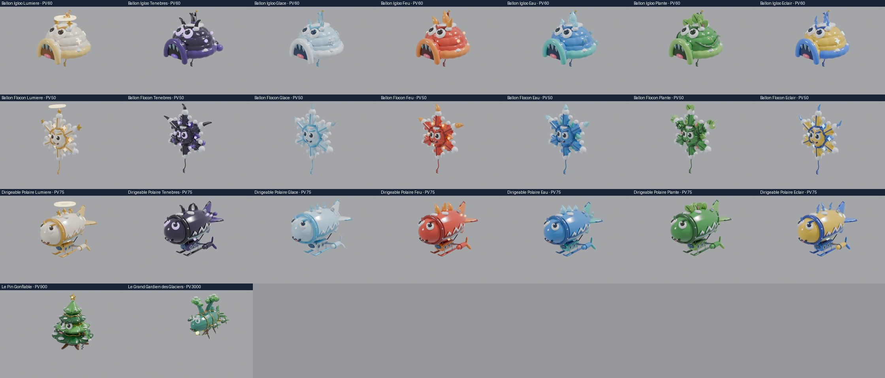

# Monde 3 — Le Royaume Givré : rapport de production



23 ennemis gonflables (3 familles × 7 types + mini-boss + boss), chacun en `.blend` et en `.fbx`
individuels, avec armature, shape keys et animations indépendantes (une Action = une prise FBX).

## Fichiers créés

| Ennemi | PV | Dimensions X×Y×Z (m) | Sommets | Triangles | Os | Actions | .blend | .fbx | FBX vérifié |
|---|---|---|---|---|---|---|---|---|---|
| Ballon Igloo Lumière | 60 | 1.41 × 1.49 × 1.62 | 12 610 | 24 796 | 18 | 5 | [`Lumiere.blend`](Blender/Ballon_Igloo/Lumiere.blend) | [`Ballon_Igloo_Lumiere.fbx`](FBX/Ballon_Igloo/Ballon_Igloo_Lumiere.fbx) | OK |
| Ballon Igloo Ténèbres | 60 | 1.49 × 1.49 × 1.62 | 12 280 | 24 120 | 18 | 5 | [`Tenebres.blend`](Blender/Ballon_Igloo/Tenebres.blend) | [`Ballon_Igloo_Tenebres.fbx`](FBX/Ballon_Igloo/Ballon_Igloo_Tenebres.fbx) | OK |
| Ballon Igloo Glace | 60 | 1.41 × 1.49 × 1.62 | 11 484 | 22 472 | 18 | 5 | [`Glace.blend`](Blender/Ballon_Igloo/Glace.blend) | [`Ballon_Igloo_Glace.fbx`](FBX/Ballon_Igloo/Ballon_Igloo_Glace.fbx) | OK |
| Ballon Igloo Feu | 60 | 1.41 × 1.49 × 1.62 | 11 418 | 22 424 | 18 | 5 | [`Feu.blend`](Blender/Ballon_Igloo/Feu.blend) | [`Ballon_Igloo_Feu.fbx`](FBX/Ballon_Igloo/Ballon_Igloo_Feu.fbx) | OK |
| Ballon Igloo Eau | 60 | 1.41 × 1.49 × 1.62 | 12 710 | 24 940 | 18 | 5 | [`Eau.blend`](Blender/Ballon_Igloo/Eau.blend) | [`Ballon_Igloo_Eau.fbx`](FBX/Ballon_Igloo/Ballon_Igloo_Eau.fbx) | OK |
| Ballon Igloo Plante | 60 | 1.41 × 1.49 × 1.62 | 19 210 | 37 736 | 18 | 5 | [`Plante.blend`](Blender/Ballon_Igloo/Plante.blend) | [`Ballon_Igloo_Plante.fbx`](FBX/Ballon_Igloo/Ballon_Igloo_Plante.fbx) | OK |
| Ballon Igloo Éclair | 60 | 1.41 × 1.49 × 1.62 | 11 370 | 22 340 | 18 | 5 | [`Eclair.blend`](Blender/Ballon_Igloo/Eclair.blend) | [`Ballon_Igloo_Eclair.fbx`](FBX/Ballon_Igloo/Ballon_Igloo_Eclair.fbx) | OK |
| Ballon Flocon Lumière | 50 | 1.56 × 0.50 × 2.20 | 10 960 | 21 544 | 19 | 5 | [`Lumiere.blend`](Blender/Ballon_Flocon/Lumiere.blend) | [`Ballon_Flocon_Lumiere.fbx`](FBX/Ballon_Flocon/Ballon_Flocon_Lumiere.fbx) | OK |
| Ballon Flocon Ténèbres | 50 | 1.76 × 0.49 × 2.12 | 10 570 | 20 748 | 19 | 5 | [`Tenebres.blend`](Blender/Ballon_Flocon/Tenebres.blend) | [`Ballon_Flocon_Tenebres.fbx`](FBX/Ballon_Flocon/Ballon_Flocon_Tenebres.fbx) | OK |
| Ballon Flocon Glace | 50 | 1.53 × 0.48 × 2.11 | 9 924 | 19 388 | 19 | 5 | [`Glace.blend`](Blender/Ballon_Flocon/Glace.blend) | [`Ballon_Flocon_Glace.fbx`](FBX/Ballon_Flocon/Ballon_Flocon_Glace.fbx) | OK |
| Ballon Flocon Feu | 50 | 1.70 × 0.48 × 2.16 | 9 708 | 19 052 | 19 | 5 | [`Feu.blend`](Blender/Ballon_Flocon/Feu.blend) | [`Ballon_Flocon_Feu.fbx`](FBX/Ballon_Flocon/Ballon_Flocon_Feu.fbx) | OK |
| Ballon Flocon Eau | 50 | 1.57 × 0.49 × 2.10 | 11 082 | 21 728 | 19 | 5 | [`Eau.blend`](Blender/Ballon_Flocon/Eau.blend) | [`Ballon_Flocon_Eau.fbx`](FBX/Ballon_Flocon/Ballon_Flocon_Eau.fbx) | OK |
| Ballon Flocon Plante | 50 | 1.64 × 0.48 × 2.11 | 18 516 | 36 372 | 19 | 5 | [`Plante.blend`](Blender/Ballon_Flocon/Plante.blend) | [`Ballon_Flocon_Plante.fbx`](FBX/Ballon_Flocon/Ballon_Flocon_Plante.fbx) | OK |
| Ballon Flocon Éclair | 50 | 1.54 × 0.48 × 2.16 | 9 720 | 19 088 | 19 | 5 | [`Eclair.blend`](Blender/Ballon_Flocon/Eclair.blend) | [`Ballon_Flocon_Eclair.fbx`](FBX/Ballon_Flocon/Ballon_Flocon_Eclair.fbx) | OK |
| Dirigeable Polaire Lumière | 75 | 1.60 × 2.12 × 1.68 | 14 896 | 29 360 | 16 | 5 | [`Lumiere.blend`](Blender/Dirigeable_Polaire/Lumiere.blend) | [`Dirigeable_Polaire_Lumiere.fbx`](FBX/Dirigeable_Polaire/Dirigeable_Polaire_Lumiere.fbx) | OK |
| Dirigeable Polaire Ténèbres | 75 | 1.60 × 2.38 × 1.53 | 14 006 | 27 584 | 16 | 5 | [`Tenebres.blend`](Blender/Dirigeable_Polaire/Tenebres.blend) | [`Dirigeable_Polaire_Tenebres.fbx`](FBX/Dirigeable_Polaire/Dirigeable_Polaire_Tenebres.fbx) | OK |
| Dirigeable Polaire Glace | 75 | 1.60 × 2.12 × 1.51 | 13 860 | 27 204 | 16 | 5 | [`Glace.blend`](Blender/Dirigeable_Polaire/Glace.blend) | [`Dirigeable_Polaire_Glace.fbx`](FBX/Dirigeable_Polaire/Dirigeable_Polaire_Glace.fbx) | OK |
| Dirigeable Polaire Feu | 75 | 1.60 × 2.12 × 1.57 | 13 644 | 26 868 | 16 | 5 | [`Feu.blend`](Blender/Dirigeable_Polaire/Feu.blend) | [`Dirigeable_Polaire_Feu.fbx`](FBX/Dirigeable_Polaire/Dirigeable_Polaire_Feu.fbx) | OK |
| Dirigeable Polaire Eau | 75 | 1.60 × 2.35 × 1.56 | 14 616 | 28 764 | 16 | 5 | [`Eau.blend`](Blender/Dirigeable_Polaire/Eau.blend) | [`Dirigeable_Polaire_Eau.fbx`](FBX/Dirigeable_Polaire/Dirigeable_Polaire_Eau.fbx) | OK |
| Dirigeable Polaire Plante | 75 | 1.60 × 2.12 × 1.52 | 21 710 | 42 724 | 16 | 5 | [`Plante.blend`](Blender/Dirigeable_Polaire/Plante.blend) | [`Dirigeable_Polaire_Plante.fbx`](FBX/Dirigeable_Polaire/Dirigeable_Polaire_Plante.fbx) | OK |
| Dirigeable Polaire Éclair | 75 | 1.60 × 2.12 × 1.57 | 13 656 | 26 904 | 16 | 5 | [`Eclair.blend`](Blender/Dirigeable_Polaire/Eclair.blend) | [`Dirigeable_Polaire_Eclair.fbx`](FBX/Dirigeable_Polaire/Dirigeable_Polaire_Eclair.fbx) | OK |
| Le Pin Gonflable | 900 | 4.03 × 5.66 × 5.01 | 41 524 | 82 188 | 30 | 10 | [`MiniBoss_Pin_Gonflable_Plante.blend`](Blender/MiniBoss_Pin_Gonflable_Plante.blend) | [`MiniBoss_Pin_Gonflable_Plante.fbx`](FBX/MiniBoss_Pin_Gonflable_Plante.fbx) | OK |
| Le Grand Gardien des Glaciers | 3000 | 8.10 × 16.14 × 9.16 | 48 704 | 95 696 | 39 | 11 | [`Boss_Gardien_Glaciers_Plante.blend`](Blender/Boss_Gardien_Glaciers_Plante.blend) | [`Boss_Gardien_Glaciers_Plante.fbx`](FBX/Boss_Gardien_Glaciers_Plante.fbx) | OK |

Aperçus : `Previews/<Famille>/<Type>.jpg` (3/4 avant · face · profil droit · 3/4 arrière) et
`Previews/<Famille>/<Type>_animations.jpg` (une ligne par Action, 6 images réparties sur sa durée).

## Animations

Toutes à 30 images/s. Les boucles (IDLE, MOVE, IDLE_Phase2) ont leur dernière image identique à la
première (et un modificateur Cycles dans Blender).

- **Ballon Igloo** : `IDLE` (61 im., 2.0 s, boucle), `MOVE` (41 im., 1.33 s, boucle), `ATTACK` (37 im., 1.2 s), `HIT` (19 im., 0.6 s), `DEATH` (61 im., 2.0 s)
- **Ballon Flocon** : `IDLE` (61 im., 2.0 s, boucle), `MOVE` (41 im., 1.33 s, boucle), `ATTACK` (37 im., 1.2 s), `HIT` (19 im., 0.6 s), `DEATH` (61 im., 2.0 s)
- **Dirigeable Polaire** : `IDLE` (61 im., 2.0 s, boucle), `MOVE` (41 im., 1.33 s, boucle), `ATTACK` (37 im., 1.2 s), `HIT` (19 im., 0.6 s), `DEATH` (61 im., 2.0 s)
- **Le Pin Gonflable** : `IDLE` (61 im., 2.0 s, boucle), `MOVE` (41 im., 1.33 s, boucle), `ATTACK` (45 im., 1.47 s), `HIT` (21 im., 0.67 s), `DEATH` (81 im., 2.67 s), `ATTACK_PommesDePin` (46 im., 1.5 s), `ATTACK_Racines` (56 im., 1.83 s), `ATTACK_ChuteNeige` (46 im., 1.5 s), `PHASE2_Deploiement` (61 im., 2.0 s), `IDLE_Phase2` (61 im., 2.0 s, boucle)
- **Le Grand Gardien des Glaciers** : `IDLE` (61 im., 2.0 s, boucle), `MOVE` (41 im., 1.33 s, boucle), `ATTACK` (51 im., 1.67 s), `HIT` (21 im., 0.67 s), `DEATH` (91 im., 3.0 s), `ATTACK_VagueRacines` (61 im., 2.0 s), `ATTACK_GrainesExplosives` (46 im., 1.5 s), `ATTACK_TempeteNeige` (61 im., 2.0 s), `ATTACK_Invocation` (51 im., 1.67 s), `PHASE2_Eveil` (61 im., 2.0 s), `IDLE_Phase2` (61 im., 2.0 s, boucle)

Shape keys (sur tous les modèles) : `Respiration` (gonflement), `Impact` (écrasement de l'avant),
`Degonfle` (froissé, aplati). Elles sont pilotées dans Blender par l'os de contrôle `CTRL_Formes`
(X/Y/Z) et cuites dans chaque prise FBX comme courbes de blend shapes ; l'os de contrôle n'est pas
exporté (os de déformation uniquement).

## Conventions

- Unités : mètres. Z vers le haut. **Avant du modèle vers +Y** (comme demandé). Pivot au sol sous le
  modèle (os `Root`), le corps flottant au-dessus.
- Un seul maillage par ennemi (multi-matériaux), skinné sur une armature (`<Nom>_Rig`). Les os ont
  une orientation de repos alignée sur les axes du monde.
- Export FBX : axes par défaut de Blender (-Z avant, Y haut côté FBX), unités en mètres,
  `add_leaf_bones` désactivé, une prise par Action nommée `<Nom>_Rig|<ACTION>`.
- Projectiles (pomme de pin, racines surgissantes, bloc de neige, graine, mini-ballons, tempête) :
  intégrés aux boss sur des os `Proj_*`, à l'échelle 0 hors de leurs attaques.

## Régénérer

```bash
bash src/run_batch.sh "igloo:glace flocon:feu pin:plante"   # ou n'importe quelle liste
blender -b --factory-startup -q -P src/verify_fbx.py -- World_3_Glace/FBX World_3_Glace/verification_fbx.json
python3 src/report.py
```

