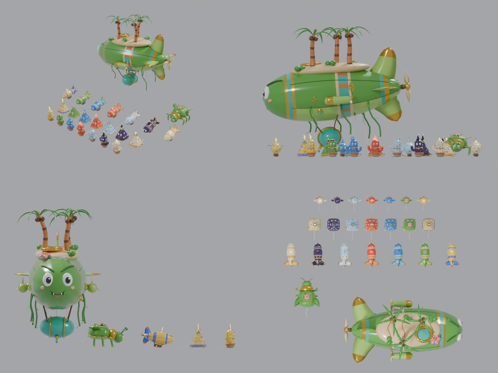

# monde2-desert

Monde 2 « Le Désert des Ballons Perdus » : planche de présentation des 23 ennemis gonflables (21 mobs en
7 types élémentaires, le mini-boss Scaraballon et le boss Grand Ballon Oasis), posés en rangs, avant vers +Y.
Les fichiers de jeu (23 .blend animés + 23 FBX) sont produits par export_all.py dans World_2_Desert/ :
ce .blend-ci n'est qu'une vitrine sans animations.

Vues : [iso_back](screenshots/iso_back.jpg) · [back](screenshots/back.jpg) · [right](screenshots/right.jpg) · [top](screenshots/top.jpg)

| Fichier | Contenu |
|---|---|
| [`monde2-desert.blend`](monde2-desert.blend) | Fichier Blender 5.2.3 LTS |
| [`build.py`](build.py) | Script qui génère le modèle |

**Dimensions** : 20.684 × 19.305 × 12.437 m (X × Y × Z) · **Objets** : 23 · **Sommets** : 140 574 · **Faces** : 149 911
