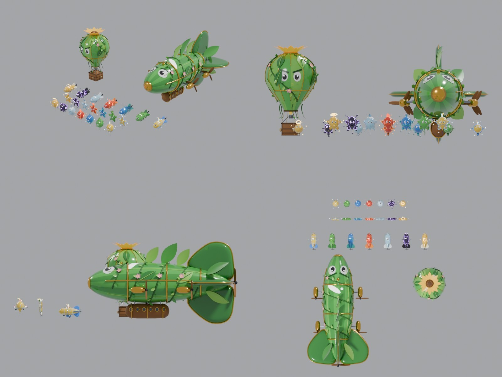

# world-1-prairie

Monde 1 « La Prairie » : les 23 ennemis gonflables réunis dans une scène de présentation (sans animations).

Rangées de devant à l'arrière : 7 Ballons Classiques, 7 Ballons Étoile, 7 Mini-dirigeables (Lumière, Ténèbres,
Glace, Feu, Eau, Plante, Éclair), puis la Montgolfière Solaire (mini-boss) et le Grand Zeppelin des Prairies (boss).
Les modèles individuels animés (.blend, FBX) et leurs aperçus sont dans World_1_Prairie/ (générés par export.py).

Vues : [iso_back](screenshots/iso_back.jpg) · [back](screenshots/back.jpg) · [left](screenshots/left.jpg) · [top](screenshots/top.jpg)

| Fichier | Contenu |
|---|---|
| [`world-1-prairie.blend`](world-1-prairie.blend) | Fichier Blender 5.2.3 LTS |
| [`build.py`](build.py) | Script qui génère le modèle |

**Dimensions** : 14.255 × 17.251 × 6.350 m (X × Y × Z) · **Objets** : 23 · **Sommets** : 197 447 · **Faces** : 206 369
