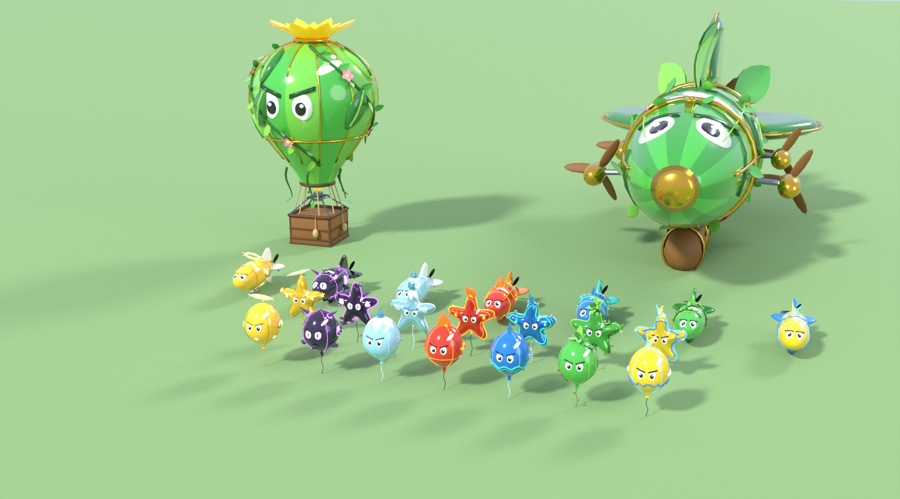

# Monde 1 — La Prairie : 23 ennemis gonflables



21 mobs normaux (3 familles × 7 éléments), 1 mini-boss et 1 boss. Chaque ennemi est un modèle indépendant : **un maillage unique + une armature + 5 Actions** (`Idle`, `Move`, `Attack`, `Hit`, `Death`), dans son propre `.blend` et son propre `.fbx`.

| Ennemi | Élément | PV | Sommets | Triangles | Os | Fichiers | Aperçus |
|---|---|---|---|---|---|---|---|
| Ballon Classique Lumière | Lumière | 15 | 4 707 | 9 254 | 32 | [blend](Blender/Ballon_Classique/Lumiere.blend) · [fbx](FBX/Ballon_Classique/Lumiere.fbx) | [vue](Previews/Ballon_Classique/Lumiere.jpg) · [animations](Previews/Ballon_Classique/Lumiere_Animations.jpg) · [attaque (gif)](Previews/Ballon_Classique/Lumiere_Attack.gif) |
| Ballon Classique Ténèbres | Ténèbres | 15 | 6 103 | 11 926 | 32 | [blend](Blender/Ballon_Classique/Tenebres.blend) · [fbx](FBX/Ballon_Classique/Tenebres.fbx) | [vue](Previews/Ballon_Classique/Tenebres.jpg) · [animations](Previews/Ballon_Classique/Tenebres_Animations.jpg) · [attaque (gif)](Previews/Ballon_Classique/Tenebres_Attack.gif) |
| Ballon Classique Glace | Glace | 15 | 6 655 | 12 760 | 32 | [blend](Blender/Ballon_Classique/Glace.blend) · [fbx](FBX/Ballon_Classique/Glace.fbx) | [vue](Previews/Ballon_Classique/Glace.jpg) · [animations](Previews/Ballon_Classique/Glace_Animations.jpg) · [attaque (gif)](Previews/Ballon_Classique/Glace_Attack.gif) |
| Ballon Classique Feu | Feu | 15 | 5 305 | 10 442 | 32 | [blend](Blender/Ballon_Classique/Feu.blend) · [fbx](FBX/Ballon_Classique/Feu.fbx) | [vue](Previews/Ballon_Classique/Feu.jpg) · [animations](Previews/Ballon_Classique/Feu_Animations.jpg) · [attaque (gif)](Previews/Ballon_Classique/Feu_Attack.gif) |
| Ballon Classique Eau | Eau | 15 | 5 883 | 11 570 | 32 | [blend](Blender/Ballon_Classique/Eau.blend) · [fbx](FBX/Ballon_Classique/Eau.fbx) | [vue](Previews/Ballon_Classique/Eau.jpg) · [animations](Previews/Ballon_Classique/Eau_Animations.jpg) · [attaque (gif)](Previews/Ballon_Classique/Eau_Attack.gif) |
| Ballon Classique Plante | Plante | 15 | 5 397 | 9 574 | 32 | [blend](Blender/Ballon_Classique/Plante.blend) · [fbx](FBX/Ballon_Classique/Plante.fbx) | [vue](Previews/Ballon_Classique/Plante.jpg) · [animations](Previews/Ballon_Classique/Plante_Animations.jpg) · [attaque (gif)](Previews/Ballon_Classique/Plante_Attack.gif) |
| Ballon Classique Éclair | Éclair | 15 | 3 537 | 6 950 | 32 | [blend](Blender/Ballon_Classique/Eclair.blend) · [fbx](FBX/Ballon_Classique/Eclair.fbx) | [vue](Previews/Ballon_Classique/Eclair.jpg) · [animations](Previews/Ballon_Classique/Eclair_Animations.jpg) · [attaque (gif)](Previews/Ballon_Classique/Eclair_Attack.gif) |
| Ballon Étoile Lumière | Lumière | 20 | 6 330 | 12 508 | 32 | [blend](Blender/Ballon_Etoile/Lumiere.blend) · [fbx](FBX/Ballon_Etoile/Lumiere.fbx) | [vue](Previews/Ballon_Etoile/Lumiere.jpg) · [animations](Previews/Ballon_Etoile/Lumiere_Animations.jpg) · [attaque (gif)](Previews/Ballon_Etoile/Lumiere_Attack.gif) |
| Ballon Étoile Ténèbres | Ténèbres | 20 | 7 284 | 14 352 | 32 | [blend](Blender/Ballon_Etoile/Tenebres.blend) · [fbx](FBX/Ballon_Etoile/Tenebres.fbx) | [vue](Previews/Ballon_Etoile/Tenebres.jpg) · [animations](Previews/Ballon_Etoile/Tenebres_Animations.jpg) · [attaque (gif)](Previews/Ballon_Etoile/Tenebres_Attack.gif) |
| Ballon Étoile Glace | Glace | 20 | 8 283 | 16 032 | 32 | [blend](Blender/Ballon_Etoile/Glace.blend) · [fbx](FBX/Ballon_Etoile/Glace.fbx) | [vue](Previews/Ballon_Etoile/Glace.jpg) · [animations](Previews/Ballon_Etoile/Glace_Animations.jpg) · [attaque (gif)](Previews/Ballon_Etoile/Glace_Attack.gif) |
| Ballon Étoile Feu | Feu | 20 | 7 200 | 14 236 | 32 | [blend](Blender/Ballon_Etoile/Feu.blend) · [fbx](FBX/Ballon_Etoile/Feu.fbx) | [vue](Previews/Ballon_Etoile/Feu.jpg) · [animations](Previews/Ballon_Etoile/Feu_Animations.jpg) · [attaque (gif)](Previews/Ballon_Etoile/Feu_Attack.gif) |
| Ballon Étoile Eau | Eau | 20 | 7 586 | 14 992 | 32 | [blend](Blender/Ballon_Etoile/Eau.blend) · [fbx](FBX/Ballon_Etoile/Eau.fbx) | [vue](Previews/Ballon_Etoile/Eau.jpg) · [animations](Previews/Ballon_Etoile/Eau_Animations.jpg) · [attaque (gif)](Previews/Ballon_Etoile/Eau_Attack.gif) |
| Ballon Étoile Plante | Plante | 20 | 7 365 | 13 290 | 32 | [blend](Blender/Ballon_Etoile/Plante.blend) · [fbx](FBX/Ballon_Etoile/Plante.fbx) | [vue](Previews/Ballon_Etoile/Plante.jpg) · [animations](Previews/Ballon_Etoile/Plante_Animations.jpg) · [attaque (gif)](Previews/Ballon_Etoile/Plante_Attack.gif) |
| Ballon Étoile Éclair | Éclair | 20 | 5 192 | 10 264 | 32 | [blend](Blender/Ballon_Etoile/Eclair.blend) · [fbx](FBX/Ballon_Etoile/Eclair.fbx) | [vue](Previews/Ballon_Etoile/Eclair.jpg) · [animations](Previews/Ballon_Etoile/Eclair_Animations.jpg) · [attaque (gif)](Previews/Ballon_Etoile/Eclair_Attack.gif) |
| Mini-dirigeable Lumière | Lumière | 30 | 6 478 | 12 716 | 30 | [blend](Blender/Mini_Dirigeable/Lumiere.blend) · [fbx](FBX/Mini_Dirigeable/Lumiere.fbx) | [vue](Previews/Mini_Dirigeable/Lumiere.jpg) · [animations](Previews/Mini_Dirigeable/Lumiere_Animations.jpg) · [attaque (gif)](Previews/Mini_Dirigeable/Lumiere_Attack.gif) |
| Mini-dirigeable Ténèbres | Ténèbres | 30 | 8 080 | 15 776 | 30 | [blend](Blender/Mini_Dirigeable/Tenebres.blend) · [fbx](FBX/Mini_Dirigeable/Tenebres.fbx) | [vue](Previews/Mini_Dirigeable/Tenebres.jpg) · [animations](Previews/Mini_Dirigeable/Tenebres_Animations.jpg) · [attaque (gif)](Previews/Mini_Dirigeable/Tenebres_Attack.gif) |
| Mini-dirigeable Glace | Glace | 30 | 7 811 | 15 104 | 30 | [blend](Blender/Mini_Dirigeable/Glace.blend) · [fbx](FBX/Mini_Dirigeable/Glace.fbx) | [vue](Previews/Mini_Dirigeable/Glace.jpg) · [animations](Previews/Mini_Dirigeable/Glace_Animations.jpg) · [attaque (gif)](Previews/Mini_Dirigeable/Glace_Attack.gif) |
| Mini-dirigeable Feu | Feu | 30 | 7 424 | 14 588 | 30 | [blend](Blender/Mini_Dirigeable/Feu.blend) · [fbx](FBX/Mini_Dirigeable/Feu.fbx) | [vue](Previews/Mini_Dirigeable/Feu.jpg) · [animations](Previews/Mini_Dirigeable/Feu_Animations.jpg) · [attaque (gif)](Previews/Mini_Dirigeable/Feu_Attack.gif) |
| Mini-dirigeable Eau | Eau | 30 | 7 910 | 15 536 | 30 | [blend](Blender/Mini_Dirigeable/Eau.blend) · [fbx](FBX/Mini_Dirigeable/Eau.fbx) | [vue](Previews/Mini_Dirigeable/Eau.jpg) · [animations](Previews/Mini_Dirigeable/Eau_Animations.jpg) · [attaque (gif)](Previews/Mini_Dirigeable/Eau_Attack.gif) |
| Mini-dirigeable Plante | Plante | 30 | 7 608 | 13 664 | 30 | [blend](Blender/Mini_Dirigeable/Plante.blend) · [fbx](FBX/Mini_Dirigeable/Plante.fbx) | [vue](Previews/Mini_Dirigeable/Plante.jpg) · [animations](Previews/Mini_Dirigeable/Plante_Animations.jpg) · [attaque (gif)](Previews/Mini_Dirigeable/Plante_Attack.gif) |
| Mini-dirigeable Éclair | Éclair | 30 | 5 690 | 11 168 | 30 | [blend](Blender/Mini_Dirigeable/Eclair.blend) · [fbx](FBX/Mini_Dirigeable/Eclair.fbx) | [vue](Previews/Mini_Dirigeable/Eclair.jpg) · [animations](Previews/Mini_Dirigeable/Eclair_Animations.jpg) · [attaque (gif)](Previews/Mini_Dirigeable/Eclair_Attack.gif) |
| Montgolfière Solaire | Plante | 250 | 11 166 | 19 500 | 30 | [blend](Blender/MiniBoss_Montgolfiere_Plante.blend) · [fbx](FBX/MiniBoss_Montgolfiere_Plante.fbx) | [vue](Previews/MiniBoss_Montgolfiere_Plante.jpg) · [animations](Previews/MiniBoss_Montgolfiere_Plante_Animations.jpg) · [attaque (gif)](Previews/MiniBoss_Montgolfiere_Plante_Attack.gif) |
| Grand Zeppelin des Prairies | Plante | 1000 | 10 795 | 19 298 | 34 | [blend](Blender/Boss_Zeppelin_Plante.blend) · [fbx](FBX/Boss_Zeppelin_Plante.fbx) | [vue](Previews/Boss_Zeppelin_Plante.jpg) · [animations](Previews/Boss_Zeppelin_Plante_Animations.jpg) · [attaque (gif)](Previews/Boss_Zeppelin_Plante_Attack.gif) |

## Animations

Durées à 30 images/s. Toutes les animations sont « sur place » : l'os `Root` ne bouge jamais, et chaque animation se termine dans la pose de repos (ou disparaît pour `Death`).

| Action | Boucle | Ballons (Classique, Étoile) | Mini-dirigeable | Montgolfière | Zeppelin | Contenu |
|---|---|---|---|---|---|---|
| `Idle` | oui | 72 i | 72 i | 96 i | 120 i | flottement vertical, oscillation, « respiration » de l'enveloppe, ficelle/nacelle qui suivent avec retard |
| `Move` | oui | 36 i | 36 i | 48 i | 60 i | inclinaison vers l'avant (+Y), flottement plus rapide, étirement sous l'accélération, avant aplati par l'air |
| `Attack` | non | 42 i | 44 i | 60 i | 72 i | recul + compression → projection brutale vers l'avant → écrasement à l'impact → petit rebond → retour |
| `Hit` | non | 18 i | 18 i | 24 i | 30 i | compression rapide, petit recul, vibration amortie, retour à la forme normale |
| `Death` | non | 60 i | 66 i | 90 i | 110 i | choc, puis dégonflement inégal (14 lobes), ratatinement en tournoyant et en chutant, disparition |

Spécificités de l'attaque : les mini-dirigeables chargent à l'horizontale (hélice qui s'emballe), la nacelle de la montgolfière bascule vers l'avant et frappe à l'impact, le zeppelin avance de tout son corps (≈ 3 m).

Chaque planche `*_Animations.jpg` montre les images clés des 5 animations vues de côté (l'avant, +Y, part vers la droite). Les GIF `*_Attack.gif` montrent l'attaque complète image par image.

## Rig et conventions

- **Axes** : avant = **+Y**, haut = +Z, unités en mètres. Le point le plus bas (bout de ficelle, nacelle) est à Z = 0, l'origine de l'objet est au sol sous le modèle.
- **Pivots** : `Motion` et `Body` sont au centre de l'enveloppe (rotations et écrasements autour du centre du ballon) ; la nacelle de la montgolfière pivote sous la bouche de l'enveloppe ; chaque hélice sur son moyeu.
- **Animations sans échelle d'os** : tout est fait en position et rotation d'os. Le corps s'écrase, s'étire et se dégonfle en déplaçant 14 os posés sur l'enveloppe. Seule exception : l'os `Body` passe à l'échelle 0 dans les dernières images de `Death` (disparition) ; un moteur qui ignore l'échelle (Roblox) garde un petit tas dégonflé : retirer l'ennemi à la fin de `Death`.
- **Os** : `Root` (sol, immobile) → `Motion` (déplacements, rotations) → `Body` → 14 `Lobe_*` (6 axes + 8 coins, posés sur l'enveloppe). Tout ce qui est fixé au corps est **enfant de l'os qui porte la peau à son point d'attache**, et cette zone de peau est pondérée à 100 % sur ce même os : visage → `Lobe_Avant` (`Paupiere_H/B_G/D`, `Pupille_G/D` + `Pupille_H/B_G/D`, `Sourcil_G/D`) ; noeud et ficelle → `Lobe_Bas` (`Ficelle_1..3`) ; hélice du mini-dirigeable → `Lobe_Arriere` ; nacelle de la montgolfière → `Lobe_Bas` ; moteurs latéraux du zeppelin → `Lobe_Gauche/Droite`. Les autres décors prennent exactement les poids de l'enveloppe sous eux. Rien ne peut se décoller, quel que soit le moteur ou sa compression d'animation.
- **Yeux animés** dans les 5 actions : clignement (les paupières haut/bas se rejoignent) et coups d'oeil en `Idle`, regard concentré en `Move`, plissement à l'anticipation puis yeux écarquillés et crispés à l'impact en `Attack`, yeux fermés de douleur en `Hit`, regard étourdi (pupilles qui tournent) puis fermeture en `Death`. Ligne « YEUX » des planches d'animation.
- **Tout est fixé** : aucune pièce ne flotte (contrôlé au repos) ; les motifs imprimés sont des autocollants épais dont la base s'enfonce dans l'enveloppe, le halo est tenu par une tige, les petits décors (étoiles, bulles, éclats, braises, étincelles, volutes) sont posés sur le ballon.
- **Budget** : 20 000 triangles maximum par ennemi (vérifié à chaque génération, colonne « Triangles »). 4 influences maximum par sommet.
- **Un seul matériau par ennemi** (`<Ennemi>_Materiau`) : toutes les couleurs sont dans une petite **texture palette** (`*_Palette.png`, 128 × 128, une case par couleur, **incrustée dans le FBX** et fournie à côté), avec des **UV** qui placent chaque face sur sa case. Lueurs (`*_Palette_Emission.png`) et rugosité/métal (`*_Palette_RM.png`) sont fournies pour les moteurs qui les utilisent. Attribut de **couleurs de sommets** (`Couleur`) en plus.
- **Propriétés personnalisées** sur l'armature (exportées dans le FBX) : `Nom`, `Famille`, `Element`, `PV`, `Avant`, `Animations`.

## FBX

Export Blender standard : `-Z` avant / `Y` haut (convention FBX), unités appliquées, pas d'os de bout (leaf bones), tous les os, une prise par Action (`<Rig>|Idle`, `<Rig>|Attack`…), toutes les images échantillonnées.
Le résultat de la vérification automatique (réimport et comparaison au `.blend`) est dans [`FBX/verification.md`](FBX/verification.md).

- **Roblox Studio** : importer le FBX avec le *3D Importer* (un seul MeshPart skinné de moins de 20 000 triangles). Appliquer `*_Palette.png` comme texture (`TextureID` ou `SurfaceAppearance.ColorMap`) si elle n'est pas reprise automatiquement. Les 5 prises sont dans le FBX ; à la fin de `Death`, retirer l'ennemi.
- **Unity** : importer le FBX en *Rig > Generic*. Les clips `Idle` et `Move` se mettent en *Loop Time*. Si les matériaux restent blancs : onglet *Materials* > *Extract Textures…* (la palette est alors extraite et reliée).
- **Unreal** : importer avec *Import Animations* ; le squelette est propre à chaque ennemi.
- **Godot 4** : importer le FBX directement ; mettre `Idle`/`Move` en boucle dans l'AnimationPlayer.

## Régénérer

```bash
blender -b --factory-startup -P models/world-1-prairie/export.py -- all --gif
blender -b --factory-startup -P models/world-1-prairie/verify_fbx.py
python3 models/world-1-prairie/make_readme.py
```

Le code source est dans `models/world-1-prairie/prairie/` : `families.py` (formes de base), `elements.py` (détails des 7 éléments), `bosses.py`, `rig.py`, `anim.py`.
